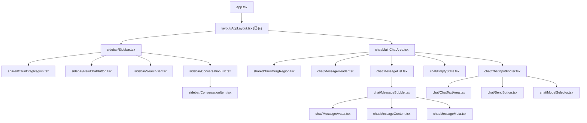

# Quick-Chat 原子组件树拆解任务清单

> [!NOTE]
> 基于 [AppLayout.tsx](file:///c:/Users/15935/Code/quick-chat/src/components/layout/AppLayout.tsx) 骨架和 [types.ts](file:///c:/Users/15935/Code/quick-chat/src/types/types.ts) 数据契约拆解。
> 每个文件控制在 **≤100 行逻辑**，可由初级程序员独立完成。

## 组件架构总览



---

## A. 共享基础组件 (shared/)

### A-1. `src/components/shared/TauriDragRegion.tsx`

| 项目 | 内容 |
|------|------|
| **核心职责** | 封装 Tauri 无边框窗口顶部拖拽区域，支持绝对定位与文档流两种模式 |
| **Props 接口** | 见下方 |
| **自定义 Hook** | 无 |

```typescript
interface TauriDragRegionProps {
  /** 拖拽区高度，默认 "h-12" */
  className?: string;
  /** true = absolute 悬浮模式 (主区域用)；false = 文档流模式 (侧边栏用) */
  floating?: boolean;
}
```

### A-2. `src/components/shared/RelativeTime.tsx`

| 项目 | 内容 |
|------|------|
| **核心职责** | 将 `EpochMillis` 时间戳渲染为相对时间文本（"3 分钟前"） |
| **Props 接口** | 见下方 |
| **自定义 Hook** | `useRelativeTime(timestamp: EpochMillis): string` — 每 60s 刷新 |

```typescript
import type { EpochMillis } from '@/types/types';

interface RelativeTimeProps {
  timestamp: EpochMillis;
  className?: string;
}
```

---

## B. 侧边栏组件 (sidebar/)

### B-1. `src/components/sidebar/Sidebar.tsx`

| 项目 | 内容 |
|------|------|
| **核心职责** | 侧边栏容器，组合拖拽区 + 新建按钮 + 搜索栏 + 会话列表 |
| **Props 接口** | 见下方 |
| **自定义 Hook** | 无（纯组合） |

```typescript
import type { ConversationSummary, UUID } from '@/types/types';

interface SidebarProps {
  conversations: ConversationSummary[];
  activeConversationId: UUID | null;
  onSelectConversation: (id: UUID) => void;
  onCreateConversation: () => void;
  onSearchChange: (query: string) => void;
  isLoading: boolean;
}
```

### B-2. `src/components/sidebar/NewChatButton.tsx`

| 项目 | 内容 |
|------|------|
| **核心职责** | "新建对话"按钮，触发 `onCreateConversation` 回调 |
| **Props 接口** | 见下方 |
| **自定义 Hook** | 无 |

```typescript
interface NewChatButtonProps {
  onClick: () => void;
}
```

### B-3. `src/components/sidebar/SearchBar.tsx`

| 项目 | 内容 |
|------|------|
| **核心职责** | 搜索输入框，带防抖后通过回调上报关键词 |
| **Props 接口** | 见下方 |
| **自定义 Hook** | `useDebounce<T>(value: T, delayMs: number): T` |

```typescript
interface SearchBarProps {
  onSearch: (query: string) => void;
  placeholder?: string;
}
```

### B-4. `src/components/sidebar/ConversationList.tsx`

| 项目 | 内容 |
|------|------|
| **核心职责** | 渲染 `ConversationSummary[]` 列表，处理空状态与加载态 |
| **Props 接口** | 见下方 |
| **自定义 Hook** | 无 |

```typescript
import type { ConversationSummary, UUID } from '@/types/types';

interface ConversationListProps {
  conversations: ConversationSummary[];
  activeId: UUID | null;
  onSelect: (id: UUID) => void;
  isLoading: boolean;
}
```

### B-5. `src/components/sidebar/ConversationItem.tsx`

| 项目 | 内容 |
|------|------|
| **核心职责** | 单条会话摘要卡片，展示标题、预览文本、时间、消息数 |
| **Props 接口** | 见下方 |
| **自定义 Hook** | 无 |

```typescript
import type { ConversationSummary } from '@/types/types';

interface ConversationItemProps {
  conversation: ConversationSummary;
  isActive: boolean;
  onSelect: () => void;
}
```

---

## C. 主对话区组件 (chat/)

### C-1. `src/components/chat/MainChatArea.tsx`

| 项目 | 内容 |
|------|------|
| **核心职责** | 主对话区容器，组合 Header + MessageList/EmptyState + InputFooter |
| **Props 接口** | 见下方 |
| **自定义 Hook** | 无（纯组合） |

```typescript
import type { Conversation, Message, UUID } from '@/types/types';

interface MainChatAreaProps {
  conversation: Conversation | null;
  messages: Message[];
  isLoadingMessages: boolean;
  onSendMessage: (content: string) => void;
  onLoadMore: () => void;
  hasMore: boolean;
}
```

### C-2. `src/components/chat/MessageHeader.tsx`

| 项目 | 内容 |
|------|------|
| **核心职责** | 对话区顶部栏，展示当前会话标题和模型标识 |
| **Props 接口** | 见下方 |
| **自定义 Hook** | 无 |

```typescript
import type { Conversation } from '@/types/types';

interface MessageHeaderProps {
  conversation: Conversation;
}
```

### C-3. `src/components/chat/EmptyState.tsx`

| 项目 | 内容 |
|------|------|
| **核心职责** | 无会话/无消息时的占位视图（品牌 Logo + 欢迎语） |
| **Props 接口** | 见下方 |
| **自定义 Hook** | 无 |

```typescript
interface EmptyStateProps {
  /** "no_conversation" = 未选会话; "no_messages" = 会话内无消息 */
  type: 'no_conversation' | 'no_messages';
}
```

### C-4. `src/components/chat/MessageList.tsx`

| 项目 | 内容 |
|------|------|
| **核心职责** | 消息列表容器，负责自动滚动到底部 + 向上滚动加载更多 |
| **Props 接口** | 见下方 |
| **自定义 Hook** | `useAutoScroll(deps: unknown[]): React.RefObject<HTMLDivElement>` — 新消息到达时自动滚底 |

```typescript
import type { Message } from '@/types/types';

interface MessageListProps {
  messages: Message[];
  onLoadMore: () => void;
  hasMore: boolean;
  isLoadingMore: boolean;
}
```

### C-5. `src/components/chat/MessageBubble.tsx`

| 项目 | 内容 |
|------|------|
| **核心职责** | 单条消息的外层容器，根据 `role` 决定布局方向（左/右对齐） |
| **Props 接口** | 见下方 |
| **自定义 Hook** | 无 |

```typescript
import type { Message } from '@/types/types';

interface MessageBubbleProps {
  message: Message;
}
```

### C-6. `src/components/chat/MessageAvatar.tsx`

| 项目 | 内容 |
|------|------|
| **核心职责** | 消息头像，根据 `MessageRole` 渲染用户/AI 图标 |
| **Props 接口** | 见下方 |
| **自定义 Hook** | 无 |

```typescript
import type { MessageRole } from '@/types/types';

interface MessageAvatarProps {
  role: MessageRole;
}
```

### C-7. `src/components/chat/MessageContent.tsx`

| 项目 | 内容 |
|------|------|
| **核心职责** | 消息正文渲染，将 Markdown `content` 渲染为 HTML；`streaming` 状态显示光标动画 |
| **Props 接口** | 见下方 |
| **自定义 Hook** | 无（使用第三方 Markdown 库如 `react-markdown`） |

```typescript
import type { MessageStatus } from '@/types/types';

interface MessageContentProps {
  content: string;
  status: MessageStatus;
}
```

### C-8. `src/components/chat/MessageMeta.tsx`

| 项目 | 内容 |
|------|------|
| **核心职责** | 消息底部元信息行：时间戳 + token 用量 + 模型标识 |
| **Props 接口** | 见下方 |
| **自定义 Hook** | 无（复用 `RelativeTime`） |

```typescript
import type { EpochMillis } from '@/types/types';

interface MessageMetaProps {
  createdAt: EpochMillis;
  tokenCount: number | null;
  modelId: string | null;
}
```

### C-9. `src/components/chat/ChatInputFooter.tsx`

| 项目 | 内容 |
|------|------|
| **核心职责** | 输入区容器，组合 TextArea + ModelSelector + SendButton，管理输入状态 |
| **Props 接口** | 见下方 |
| **自定义 Hook** | 无 |

```typescript
interface ChatInputFooterProps {
  onSend: (content: string) => void;
  disabled: boolean;
}
```

### C-10. `src/components/chat/ChatTextArea.tsx`

| 项目 | 内容 |
|------|------|
| **核心职责** | 自适应高度的多行文本输入框，支持 `Ctrl+Enter` / `⌘+Enter` 发送 |
| **Props 接口** | 见下方 |
| **自定义 Hook** | `useAutoResize(ref: RefObject<HTMLTextAreaElement>): void` — 根据内容自动调整高度 |

```typescript
interface ChatTextAreaProps {
  value: string;
  onChange: (value: string) => void;
  onSubmit: () => void;
  disabled: boolean;
  placeholder?: string;
}
```

### C-11. `src/components/chat/SendButton.tsx`

| 项目 | 内容 |
|------|------|
| **核心职责** | 发送按钮，空内容或 `disabled` 时置灰 |
| **Props 接口** | 见下方 |
| **自定义 Hook** | 无 |

```typescript
interface SendButtonProps {
  onClick: () => void;
  disabled: boolean;
}
```

### C-12. `src/components/chat/ModelSelector.tsx`

| 项目 | 内容 |
|------|------|
| **核心职责** | 模型选择下拉菜单，展示当前模型名称，点击切换 |
| **Props 接口** | 见下方 |
| **自定义 Hook** | 无 |

```typescript
import type { ModelConfig, UUID } from '@/types/types';

interface ModelSelectorProps {
  models: ModelConfig[];
  activeModelId: UUID;
  onSelect: (id: UUID) => void;
}
```

---

## D. 自定义 Hooks 汇总 (hooks/)

| 文件路径 | 职责 | 签名 |
|----------|------|------|
| `src/hooks/useDebounce.ts` | 通用防抖 Hook | `useDebounce<T>(value: T, delay: number): T` |
| `src/hooks/useRelativeTime.ts` | 将时间戳转为相对时间文本，定时刷新 | `useRelativeTime(ts: EpochMillis): string` |
| `src/hooks/useAutoScroll.ts` | 依赖变化时自动滚动到容器底部 | `useAutoScroll(deps: unknown[]): RefObject<HTMLDivElement>` |
| `src/hooks/useAutoResize.ts` | textarea 高度自适应内容 | `useAutoResize(ref: RefObject<HTMLTextAreaElement>): void` |

---

## E. 目录结构预览

```
src/components/
├── layout/
│   └── AppLayout.tsx          ← 已有
├── shared/
│   ├── TauriDragRegion.tsx    ← A-1
│   └── RelativeTime.tsx       ← A-2
├── sidebar/
│   ├── Sidebar.tsx            ← B-1
│   ├── NewChatButton.tsx      ← B-2
│   ├── SearchBar.tsx          ← B-3
│   ├── ConversationList.tsx   ← B-4
│   └── ConversationItem.tsx   ← B-5
└── chat/
    ├── MainChatArea.tsx       ← C-1
    ├── MessageHeader.tsx      ← C-2
    ├── EmptyState.tsx         ← C-3
    ├── MessageList.tsx        ← C-4
    ├── MessageBubble.tsx      ← C-5
    ├── MessageAvatar.tsx      ← C-6
    ├── MessageContent.tsx     ← C-7
    ├── MessageMeta.tsx        ← C-8
    ├── ChatInputFooter.tsx    ← C-9
    ├── ChatTextArea.tsx       ← C-10
    ├── SendButton.tsx         ← C-11
    └── ModelSelector.tsx      ← C-12

src/hooks/
    ├── useDebounce.ts         ← D-1
    ├── useRelativeTime.ts     ← D-2
    ├── useAutoScroll.ts       ← D-3
    └── useAutoResize.ts       ← D-4
```

---

## F. 推荐实施顺序

> [!TIP]
> 无依赖的叶子组件优先，容器组件最后组装。

| 批次 | 组件 | 理由 |
|------|------|------|
| **P0 — 基础层** | A-1, A-2, D-1 ~ D-4 | 零依赖，所有上层组件复用 |
| **P1 — 叶子组件** | B-2, B-3, B-5, C-6, C-7, C-8, C-11 | 仅依赖 Props + shared，可并行开发 |
| **P2 — 组合组件** | B-4, C-3, C-5, C-10, C-12 | 依赖 P1 叶子 |
| **P3 — 容器组件** | B-1, C-4, C-9, C-2 | 组装 P1 + P2 |
| **P4 — 页面组装** | C-1, 改造 AppLayout | 最终集成 Sidebar + MainChatArea |
